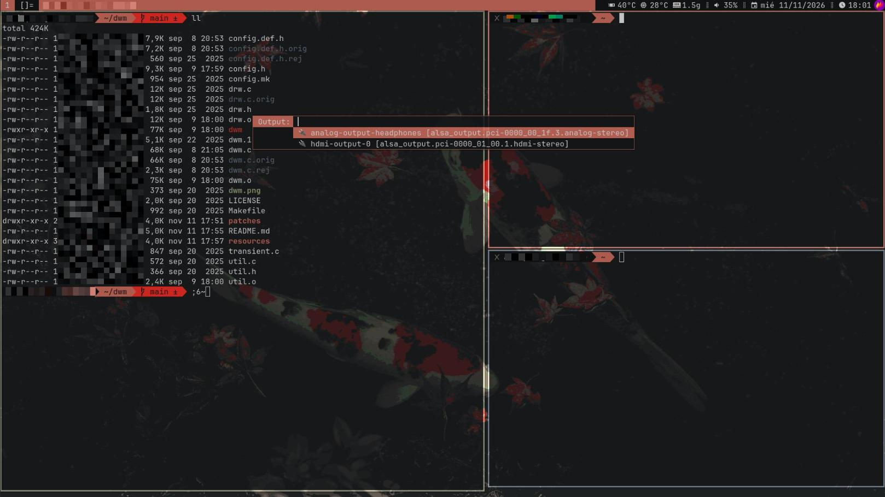

# DWM - Dynamic Window Manager (nyaboron's build)



## Repositorios que forman la build

Esta build de DWM está preparada para trabajar en conjunto con los siguientes componentes:

* [scripts](https://github.com/nyaboronn/scripts): utilidades en Bash mapeadas a atajos de teclado (*shortcuts*) en DWM.

* [dwmblocks](https://github.com/nyaboronn/dwmblocks): barra de estado modular con parche `statuscmd`.

* [st](https://github.com/nyaboronn/st): Suckless Terminal con parches estéticos (`alpha`, colores `xrdb`) y soporte para `scrollback`.

* [dmenu](https://github.com/nyaboronn/dmenu): menú dinámico con parches estéticos (`alpha`, colores `xrdb` y centrado).

## Parches

* [dwm-attachaside-6.4](https://dwm.suckless.org/patches/attachaside/dwm-attachaside-6.4.diff): fija el cliente principal a la izquierda.

* [dwm-systray-6.3](https://dwm.suckless.org/patches/systray/dwm-systray-6.3.diff): soporte para la bandeja del sistema (*system tray*).

* [dwm-gaps-6.0](https://dwm.suckless.org/patches/gaps/dwm-gaps-6.0.diff): añade espacio entre ventanas (*gaps*).

* [dwm-restartsig-20180523-6.2](https://dwm.suckless.org/patches/restartsig/dwm-restartsig-20180523-6.2.diff): permite reiniciar DWM sin cerrar sesión.

* [dwm-xrdb-6.4](https://dwm.suckless.org/patches/xrdb/dwm-xrdb-6.4.diff): soporte para leer los colores desde `xrdb`.

* [dwm-hide_vacant_tags-6.4.diff](https://dwm.suckless.org/patches/hide_vacant_tags/dwm-hide_vacant_tags-6.4.diff): oculta los tags sin ventanas activas.

* [dwm-statuscmd-20260124-a9aa0d8](https://dwm.suckless.org/patches/statuscmd/dwm-statuscmd-20260124-a9aa0d8.diff): soporte para acciones interactivas en la barra de estado.

## Atajos de teclado (Shortcuts)

* **MODKEY**: Windows

* **Terminal**: Win + Enter

* **Cerrar ventana**: Win + W

* **Zoom**: Win + Z (eleva el cliente actual a principal)

* **Navegador**: Win + B

* **Alternar barra**: Win + O

* **Menú de fondos (Wallpaper)**: Win + Shift + F6

## Requisitos

### 1. Fuente

```
pacman -S ttf-jetbrains-mono
```

### 2. Control multimedia

Para gestionar volumen, brillo y micrófono desde el teclado:

```
pacman -S libx11
```

### 3. Pywal16

Instalación del generador de esquemas de colores en la [Wiki de Pywal16](https://github.com/eylles/pywal16/wiki).

#### Plantilla de Pywal para DWM (`colors.Xresources`)

Para que DWM pueda leer la paleta generada por Pywal, copia la plantilla personalizada incluida en este repositorio a la carpeta de plantillas de Pywal:

```
mkdir -p ~/.config/wal/templates
cp resources/colors.Xresources ~/.config/wal/templates/colors.Xresources

```

*(Ver [Anexo A](#anexo-a-integración-de-pywal-y-xrdb) para más detalles sobre cómo funciona esta integración).*

## Notificaciones

Gestión de notificaciones mediante **Dunst**, configurado para usar las variables de `xrdb`:

``` bash
# Instalar Dunst
sudo pacman -S dunst

# Generar y aplicar configuración
mkdir -p ~/.config/dunst
cp ~/dwm/resources/generate_config.sh ~/.config/dunst/generate_config.sh
chmod +x ~/.config/dunst/generate_config.sh
```

## Instalación

Clonar los repositorios necesarios en el home (`~`) y compilar cada uno ejecutando `sudo make clean install`:

```
git clone https://github.com/nyaboronn/dwm.git
cd dwm
sudo make clean install
```

*(Repetir el procedimiento de compilación para `st`, `dmenu` y `dwmblocks`).*

Para lanzar DWM al iniciar la sesión de X11:

```
echo "exec dwm" >> ~/.xinitrc
```

> **Nota:** Se incluye una plantilla de referencia para el entorno en `resources/.xinitrc`.

## Anexo A: Integración de Pywal y xrdb

### Funcionamiento de Pywal

Con **pywal** se genera un esquema de colores a partir de una imagen de fondo:

```
wal -i ~/ruta/imagen.png
```

Al ejecutar este comando, Pywal guarda la paleta en `~/.cache/wal/` y ejecuta `xrdb` para fusionar las variables de color. Para restaurar el último esquema (por ejemplo, en el `.xinitrc`):

```
wal -R
```

### ¿Por qué es necesaria la plantilla `colors.Xresources`?

El parche **xrdb** de DWM busca específicamente variables que empiecen por el prefijo `dwm.`:
```
XRDB_LOAD_COLOR("dwm.normbordercolor", normbordercolor);
XRDB_LOAD_COLOR("dwm.normbgcolor",     normbgcolor);
XRDB_LOAD_COLOR("dwm.normfgcolor",     normfgcolor);
XRDB_LOAD_COLOR("dwm.selbordercolor",  selbordercolor);
XRDB_LOAD_COLOR("dwm.selbgcolor",      selbgcolor);
XRDB_LOAD_COLOR("dwm.selfgcolor",      selfgcolor);
```

Por defecto, Pywal usa una plantilla genérica que no define estas claves `dwm.*` (motivo por el cual programas como **st** o **rofi** se actualizan automáticamente tras ejecutar `wal -i`, pero DWM no).

La plantilla en `resources/colors.Xresources` define los "huecos" (`{color0}`, `{background}`, etc.) con las claves con prefijo `dwm.` necesarias.

### Verificación y Recarga

Puedes verificar si las claves de DWM están cargadas en la base de datos de X resources con:

```
xrdb -query | grep '^dwm\.'
```

Una vez generada una nueva paleta, puedes recargar los colores en DWM utilizando el atajo **`Mod + F5`** (definido por el parche `xrdb`) o reiniciando la sesión.